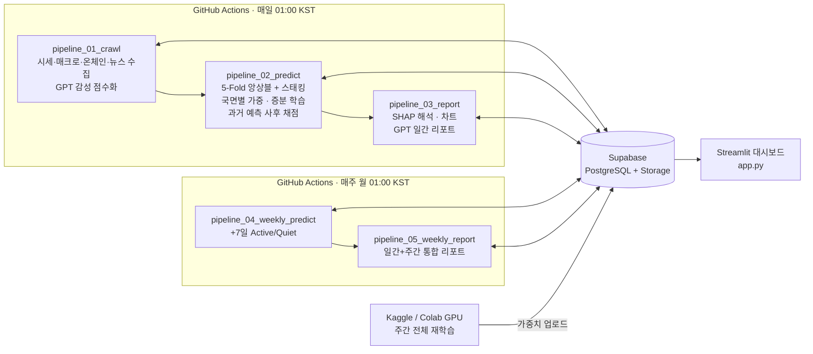

# BTC Prediction Dashboard

비트코인의 **다음 날 가격 방향**(+1일)과 **다음 주 변동성 장세**(+7일, Active/Quiet)를 예측하고,
그 근거를 사람이 읽을 수 있는 리포트로 만들어 대시보드로 제공하는 **엔드투엔드 MLOps 파이프라인**입니다.

데이터 수집 → 뉴스 감성 분석 → 피처 생성 → 앙상블 예측 → 사후 채점 → 리포트 생성까지
GitHub Actions로 **매일 자동 실행**됩니다. 유료 인프라 없이 무료 SaaS 조합으로 구성했습니다.

- **기간**: 2025.12 ~ 2026.03 (10주)
- **인원**: 1명 (기획·데이터·모델링·파이프라인·대시보드 전담, 금융 도메인 자문 1인)

<!-- 대시보드 스크린샷: docs/images/dashboard.png 를 추가한 뒤 아래 주석을 해제하세요 -->
<!--  -->

---

## 결과

시간 순서로 학습/테스트를 분할하고(과거 데이터로 학습 → 이후 기간으로 평가), 테스트 구간에서 측정했습니다.

### +1일 방향 예측 (UP / DOWN)

| 모델 | 테스트 정확도 |
| --- | --- |
| Chronos 단독 (사전학습 시계열 모델, 비교 기준) | 50.2% |
| **본 앙상블 (전체 예측)** | **59.0%** (n = 11,950) |

예측 확신도가 높을수록 실제 정확도도 단조롭게 올라가, 확신도가 높은 날만 신호를 내는 방식으로 활용했습니다.

| 확신도 기준 | 해당 비율 | 정확도 |
| --- | --- | --- |
| 50% 이상 (전체) | 100.0% | 59.0% |
| 60% 이상 | 47.3% | 63.3% |
| 65% 이상 | 26.1% | 67.5% |
| 70% 이상 | 10.2% | 71.7% |

> 백테스트 수익률은 설정에 따라 결과 편차가 매우 커서(1년 기준 +286% ~ -68%) 성능 지표로 쓰지 않았습니다.

---

## 시스템 구조



| 계층 | 사용 기술 | 역할 |
| --- | --- | --- |
| 데이터 | Supabase (PostgreSQL + Storage) | 피처·예측·리포트·모델 가중치의 단일 저장소 |
| 수집 | CCXT, PyUpbit, yfinance, fredapi, Blockchain.info, Fear & Greed API, pygooglenews | 시세, 매크로·유동성, 온체인, 뉴스 |
| 감성 분석 | LangChain + gpt-4o-mini | 뉴스 헤드라인 → sentiment(-1~1), impact(0~1) |
| 모델 | PyTorch (CNN-LSTM, PatchTST + RevIN), CatBoost, XGBoost | 앙상블 + 3단 스태킹 메타러너 |
| 학습 | Kaggle / Colab GPU, Optuna | 주간 전체 재학습, 하이퍼파라미터 탐색 |
| 해석 | SHAP, gpt-4o-mini | 피처 기여도 → 자연어 리포트 |
| 자동화 | GitHub Actions | 일간·주간 파이프라인 스케줄 실행 |
| 서빙 | Streamlit, Plotly | 예측·감성·기술 지표·리포트 대시보드 |

---

## 핵심 설계 결정

### 1. 성격이 다른 세 모델의 앙상블
정형 데이터에 강한 **CatBoost**, 국소 패턴을 잡는 **CNN-LSTM**, 긴 시계열을 패치 단위로 보는 **PatchTST**를 결합했습니다.
단순 평균에서는 약한 모델이 전체 성능을 끌어내렸기 때문에, 검증 성능 기준으로
가중 앙상블 → 3단 스태킹(XGBoost 메타러너) → **시장 국면(bull / bear / high_vol / sideways)별 동적 가중**으로 발전시켰습니다.

### 2. 문제 재정의: 7일 '방향' 대신 '변동성 장세'
7일 뒤 상승/하락/횡보를 맞추는 3분류는 테스트 정확도 22%로 실패했습니다. 과거 상승장을 학습해 "무조건 상승"으로 쏠리는 편향 때문이었습니다.
방향은 무작위에 가깝지만 **변동성은 몰려다닌다**(volatility clustering)는 점에 착안해,
"이번 주에 ±1.5% 경계를 3번 이상 건드리는 활발한 장인가"를 맞추는 **이진 분류로 타겟을 바꿨습니다**.
방향은 +1일 모델이, 거래할 만한 장인지는 +7일 모델이 판단하도록 역할을 나눴습니다.

### 3. 성능이 나아질 때만 교체하는 조건부 배포
주간 재학습한 새 모델이 기존 모델보다 검증 성능이 좋을 때만 프로덕션 가중치를 교체합니다(Safety Lock).

### 4. 예측의 사후 채점
매일 파이프라인이 24시간 전 예측을 Binance/Upbit 1분 캔들로 대조해 `is_correct`를 기록하고,
대시보드에서 최근 30일 정확도를 공개합니다.

### 5. 분포 이동(Distribution Shift) 대응
Walk-Forward 검증에서 구간별 성능 편차가 크게 나타나, 주간 전체 재학습과 최근 데이터 가중(temporal decay)을 적용했습니다.

---

## 한계와 알려진 이슈

평가 결과를 해석할 때 주의해야 할 점을 숨기지 않고 기록합니다.

- **+7일 모델은 아직 기준선을 넘지 못했습니다.** 테스트 정확도는 79.4%였지만, 실제 Active 비율이 15.8%여서
  항상 "Quiet"라고 답해도 84.2%가 나옵니다. 또한 임계값을 테스트 결과를 보고 골랐기 때문에 이 수치는 낙관적입니다.
  앞으로 Active 클래스의 정밀도·재현율과 검증셋 기반 임계값 선택으로 다시 평가할 예정입니다.
- **학습/테스트 경계의 정답 중첩:** 시간 단위 표본에 24시간 뒤 방향을 타겟으로 쓰기 때문에,
  경계 부근 약 24개 표본의 정답 구간이 겹칠 수 있습니다. 전체 테스트 대비 영향은 작지만,
  다음 버전에서는 학습과 테스트 사이에 정답 기간만큼 간격(purge)을 둘 예정입니다.
- **Walk-Forward 구간별 편차:** 주간 모델의 5단계 Walk-Forward 평균은 76.6%였지만 표준편차가 10%p로 컸습니다.
- 학습 노트북(Kaggle)은 현재 이 레포에 포함돼 있지 않습니다. 정리 후 `notebooks/`에 추가할 예정입니다.

---

## 파일 구성

| 파일 | 역할 |
| --- | --- |
| `pipeline_01_crawl.py` | 뉴스 수집·감성 분석, 시세·매크로·온체인 수집, 피처 생성 → `features_master` |
| `pipeline_02_predict.py` | 모델 로드, 앙상블·스태킹·국면별 가중 예측, 증분 학습, 과거 예측 채점 → `predictions` |
| `pipeline_02_backtest.py` | 과거 학습 → 미래 구간 백테스트 (`pipeline_02_predict.py` 실행 후 사용) |
| `pipeline_03_report.py` | SHAP 분석, 차트 생성, 일간 AI 리포트 |
| `pipeline_04_weekly_predict.py` | +7일 Active/Quiet 예측 → `weekly_predictions` |
| `pipeline_05_weekly_report.py` | 일간·주간 예측을 통합한 주간 리포트 |
| `app.py` | Streamlit 대시보드 |
| `.github/workflows/` | 일간·주간 파이프라인 스케줄 |

---

## 실행 방법

```bash
pip install -r requirements_actions.txt   # 파이프라인
pip install -r requirements.txt           # 대시보드
```

`.env` 또는 GitHub Actions Secrets에 아래 값을 설정합니다.

```
SUPABASE_URL=
SUPABASE_KEY=
SUPABASE_SERVICE_KEY=
OPENAI_API_KEY=
FRED_API_KEY=
```

```bash
python pipeline_01_crawl.py
python pipeline_02_predict.py
python pipeline_03_report.py
streamlit run app.py
```

> 모델 가중치(`.pth`, `.cbm`, `.pkl`)는 용량 문제로 레포에 포함하지 않으며, 파이프라인 실행 시 Supabase Storage에서 내려받습니다.

---

## 다음 단계

- 학습·평가 노트북 공개 및 평가 지표 재정리 (+7일 모델: 클래스별 정밀도·재현율)
- 학습/테스트 사이 purge 간격을 둔 재평가
- iTransformer 기반 다변량 모델 비교 실험

---

*이 프로젝트는 투자 조언이 아니며, 예측 결과는 학습·연구 목적으로만 제공됩니다.*
